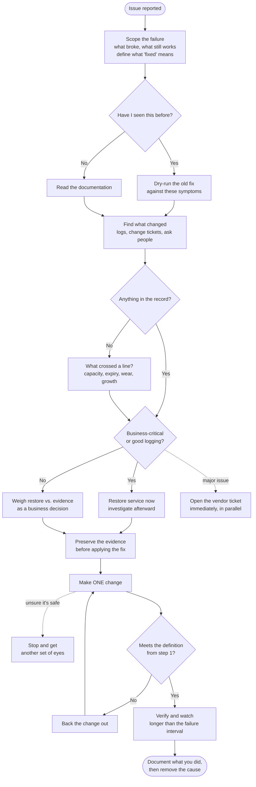

# How I Troubleshoot

A working guide to my process, written down so it can be used, questioned, and improved by others.

## Why this exists

Most of how I work a problem lives in my head. It came from twenty years of infrastructure work, and it isn't written anywhere. This document is my attempt to make it explicit.

It isn't a runbook. There's no system-specific procedure here. It's the *reasoning*, the order I do things in, the decisions I make along the way, and why. The examples are drawn from infrastructure work because that's my world, but the method applies anywhere. If you work in a different corner of IT, read past the specifics to the decision underneath.

## The short version

1. **Scope it.** What exactly is broken, what still works, and how will I know when it's fixed?
2. **Ask whether I've seen this before.** That answer decides where I start.
3. **Find out what changed** or what crossed a line.
4. **Decide:** restore service now, or investigate now?
5. **Preserve evidence** the fix will destroy — before applying the fix.
6. **Change one thing at a time.** Back it out if it doesn't work.
7. **Bring in help** on the right trigger, not after I'm out of ideas.
8. **Verify against the definition from step 1**, not against a feeling.
9. **Write down what I did, and fix the thing that let it happen.**

The rest of this document explains each one.

## The same thing as a diagram

The only loop is the backout: every failed attempt returns the system to a known state before the next one starts. The dashed branches run alongside the work rather than diverting it.

If your wiki doesn't render Mermaid, paste the block above into mermaid.live to export it as an image.

---

## 1. Scope the failure before you theorize about it

The instinct under pressure is to jump to a cause. Ten minutes spent bounding the problem first will usually save an hour, because it eliminates whole categories of cause before you've tested a single one.

Four questions:

- **What exactly is broken?** Not "the app is down" — what specific behavior fails, with what error, at what step?
- **What still works?** This is the one people skip, and it's the most valuable. Everything that still works is a layer you've just ruled out.
- **How wide is it?** One user, one VM, one host, one cluster, one site, everyone? The boundary of the failure usually points straight at the shared component responsible for it.
- **When did it start, and is it constant or intermittent?** Intermittent problems need a different approach and a much stricter standard for calling them fixed.

Then, before you touch anything, answer one more:

- **How will I know it's fixed?** Define it now, in a way you could show someone. "Users stop complaining" isn't a definition. "This query returns in under two seconds" or "the VM powers on and stays up through a vMotion" is. If you don't set this before you start changing things, you'll be tempted to accept the first sign of improvement as success.

> **Illustration:** "Nobody in the branch office can reach the file share." Scoping it out: they can reach everything *else* in the datacenter, and users in HQ reach the same share fine. That single answer eliminates the file server, its storage, and its permissions, and points at the path between one site and one service. You haven't diagnosed anything yet, but you've thrown away three quarters of the search space.

## 2. Ask: have I seen this before?

Now read what's described in the ticket against your own experience. Have you dealt with this problem, or something similar? That answer determines where you start.

**If I recognize it:** I pull from my experience and my history with that system. But recognizing something isn't the same as solving it. Before I act, I run the old fix through my head against the current symptoms and ask whether it would actually resolve *this*. Often it wouldn't, and thinking it through for thirty seconds saves an hour of going down a familiar road that doesn't lead anywhere this time.

**If I don't recognize it:** I switch modes. I ask what could have changed, and I go read the documentation for the system. There's no shame in this and it isn't slower — bluffing your way through an unfamiliar system by pattern-matching from a different one is how you make things worse.

> **Why this matters:** experience is an accelerator, not an answer. The mental dry run is what keeps pattern recognition from turning into an assumption you're now committed to. And note the order — scoping comes first deliberately, because if you pattern-match before you've bounded the problem, you'll match on symptoms that turn out to be irrelevant.

## 3. Find out what changed — or what crossed a line

Systems that worked yesterday and don't work today usually changed. I look at:

- **Logs** — what the system says about itself, at and just before the failure
- **Change tickets** — what was scheduled, approved, and applied
- **People** — I ask. Directly.

Asking matters more than it sounds like. Plenty of changes never make it into a ticket: a setting adjusted during a support call, a certificate that renewed, a patch that installed on schedule. If the record says nothing changed but the behavior says otherwise, the record is incomplete. Keep asking.

**When the answer really is "nothing changed":** this is a real category, not a dead end, and it's where the question has to shift from *what changed* to *what crossed a line*. Some failures arrive on their own schedule:

- **Capacity thresholds** — a datastore, a filesystem, a memory pool, a connection limit finally filling up
- **Gradual degradation** — a failing disk, a marginal transceiver, a leak that took weeks to matter
- **Growth against a fixed limit** — the same workload, more of it, hitting a ceiling nobody sized for
- **Expiry** — certificates, licenses, tokens, passwords, scheduled key rotations
- **Latent bugs** — a defect that was always there, triggered now by scale, uptime, or a specific data pattern

Each of those looks like "nothing changed" from the change record's point of view. Checking trends and thresholds is how you catch them, and trends are what turn a mystery into an obvious answer.

> **Illustration:** A cluster starts throwing storage latency alerts on a Monday. No change ticket exists. Two possibilities worth checking in parallel: a firmware update applied Saturday and tracked in another team's queue, or a datastore that has been filling for six weeks and just crossed the threshold where things fall apart. Both look identical on Monday morning. Only one of them shows up in the change record.

## 4. Decide: restore service, or keep investigating?

This is a judgment call, and it's the one that most separates people who've done this a long time from people who haven't. My rule:

**If the system is business-critical, or if it has good logging, I restore service as fast as I can.** I troubleshoot afterward using the best data available. Good logging means the evidence survives the reboot — I can chase root cause later without keeping the business down.

**If neither is true**, the calculation is harder, because restoring may mean I never learn what happened. That trade-off is a business decision as much as a technical one, and it should be made deliberately rather than by default.

What I don't do is chase root cause while the business is stopped when I could restore first and chase it after. Being right eventually isn't worth being down now.

## 5. Preserve evidence before you fix

Directly connected to the step above, and easy to forget under pressure.

Before I apply a fix, I ask: **what will this destroy?** Reboots clear volatile logs. Failovers move the workload away from the evidence. Rebuilds erase the state that would have told me what happened.

Whatever I know will be overwritten, I collect first. Log bundles, a support bundle, a screenshot of the console error, the current configuration. It costs a couple of minutes and it's the difference between fixing the problem once and fixing it every month.

## 6. One change at a time and back it out

This is the discipline I'd most want someone to take away from this document, because it's the mistake I see most often.

**If you try several fixes at once and the problem goes away, you don't know what fixed it.** You've restored service and learned nothing. The next time it happens — and it will happen again — you're starting from zero, except now you have four superstitions instead of one fact.

So: one change, then evaluate against the definition you wrote in step 1. **If it didn't fix it, I back it out before trying the next thing.** Stacked changes that nobody removed become the permanent, undocumented state of the system, and six months later somebody is troubleshooting a problem caused by a fix for a problem that no longer exists.

> **On pressure:** sometimes someone above you wants everything tried at once. I follow the steps and the process I've learned over my career, and I trust that the people above me will understand there's a reason for it. Being able to say "here's what I changed and here's what it did" is worth more to them than speed, and generally they know that.

## 7. Know when to bring in help

Two different situations, two different answers.

**Major issue:** I open a ticket with the vendor immediately. Not after I've exhausted my ideas — immediately. A vendor can take hours to respond, so that clock should start running while I work the steps I already know. If I solve it before they call back, nothing is lost.

**Anything less than major:** I work it myself. I keep going until I hit the line where **I'm no longer sure whether my next step could make things worse.** That's the stop point. Uncertainty about consequences is the trigger to get another set of eyes on it — a colleague, another team, or the vendor.

That line is more useful than a time limit. It's not about how long you've been stuck, it's about whether you still understand what your actions will do.

## 8. Verify against the definition, not against a feeling

Restoring normal function isn't always the same as resolving the issue, and "it looks fine now" is not a test.

Go back to the definition of fixed you wrote in step 1 and check against that. Then decide how long to watch:

- **A system I know well and a fix I trust:** normal function is enough. Close it.
- **Unfamiliar, or a fix that historically doesn't always take:** I wait a couple of days to see whether the resolution held before closing the ticket.
- **Anything intermittent:** the waiting period has to be longer than the longest gap between occurrences, or you've proven nothing. If it failed every three days, three days of health is not evidence.

Intermittent problems love to look fixed. A system that's been healthy for ten minutes has told you almost nothing.

## 9. Document what you did, then close the loop

**Write down the process, not just the outcome.** "Rebooted the host, issue resolved" helps no one, including me in a year. Six fields, and it should take five minutes:

- **Symptom** — what was actually observed, in the reporter's words and in measurable terms
- **Scope** — what was affected and what wasn't
- **Ruled out** — what you eliminated and how. This is the part everyone omits and the part that saves the most time later.
- **Cause** — what it turned out to be, or honestly, "unconfirmed" if you restored service without proving it
- **Fix** — what you changed, exactly
- **Verified by** — what convinced you it worked, and how long you watched

Write it where the next person will actually look. A ticket note is findable if people search tickets; a knowledge base article is better for anything you expect to recur. The test is simple: if this problem hits at 2 a.m. in eighteen months and you're on vacation, will whoever's on call find this?

**Then ask the question that ends the cycle: what should change so this doesn't happen again?** Options, roughly in order of preference:

- Fix the underlying cause permanently rather than the symptom
- Add or adjust monitoring so it's caught before users notice — especially for anything you found in the "crossed a line" category, since those are all predictable in hindsight
- Update the standard build, template, or configuration so new systems don't inherit it
- Track the vendor bug and the version that resolves it
- If none of the above are possible, at minimum make sure the documentation is good enough that the next occurrence takes ten minutes instead of a day

Root cause with no prevention step means you'll keep finding the same root causes.

---

## Common failure modes

Things I watch for, in myself and others:

- **Theorizing before scoping.** Ten minutes of bounding the problem beats an hour of testing guesses.
- **Multiple simultaneous changes.** The big one. You lose the ability to say what worked.
- **Leaving failed fixes in place.** Back them out.
- **Pattern-matching without checking.** "I've seen this before" is a hypothesis, not a diagnosis.
- **Trusting the change record over the evidence.** If the system says something changed, something changed.
- **Stopping at "nothing changed."** Then ask what crossed a line.
- **Fixing before collecting.** The evidence is gone the moment you reboot.
- **Calling it closed too early.** Especially on intermittent problems.
- **Escalating too late.** Particularly with vendors, where the wait is the expensive part.
- **Solving it and writing nothing down.** You've done the work and thrown away the value.

## If you take one thing from this

Work so that when the problem is solved, **you can say what solved it.** Almost everything above serves that goal: the scoping, the mental dry run, the single change, the backout, the preserved logs, the waiting period, the written record.

Anyone can get a system running again by trying things. The point is to get it running again *and know why*, so the next person — often you — doesn't start over.
